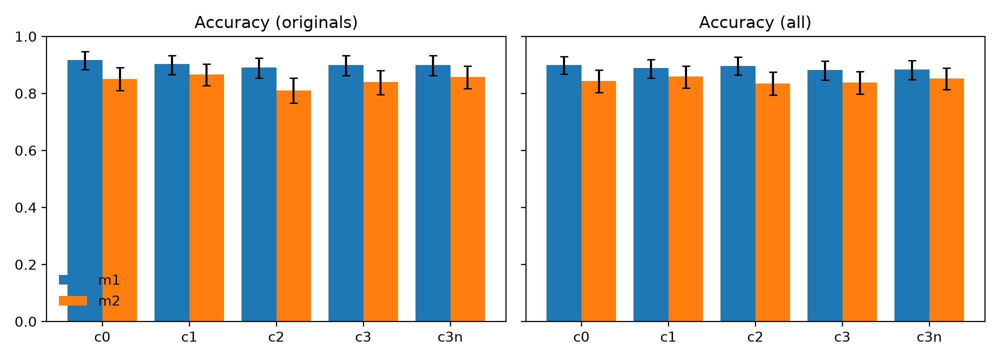
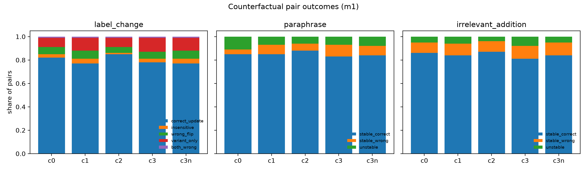
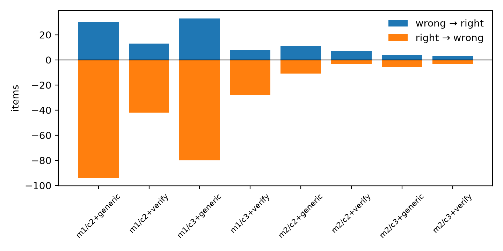

# Do LLM Explanations Track the Evidence? A Counterfactual Evaluation of Prediction–Explanation Consistency on e-SNLI

**Project 26 · Natural Language Processing · University of Oulu**
**Authors:** [names]  **Date:** [submission date]

> **Draft status.** Every number in this draft is taken from `reports/tables/` (generated by `python -m cfx.analysis`). Sections marked **[PENDING]** depend on the manual annotation that is still in progress: the cited/uncited interventions (RQ4), the human evaluation and the phenomenon tags. Their methods are written; only the results remain.

---

## Abstract

Large language models are often asked to justify their answers, and those justifications are easy to read as a window into how the answer was reached. We test that reading on natural language inference. Using 300 e-SNLI test examples and 300 hand-verified counterfactual edits of 100 of them, we compare two open-weights models from the Qwen3 family (235B and 30B mixture-of-experts) under five output formats: label only, label then explanation, evidence first, a structured format with quoted spans, and the same structured format without quotes. We ask whether producing explanations costs accuracy, whether labels and explanations update when an edit should change the answer, whether they stay put when it should not, and whether a targeted verification step repairs mistakes better than a generic "check your answer" prompt.

Three findings stand out. First, asking for explanations costs the large model almost nothing, and no format differs significantly from label-only prediction for it. The smaller model, however, loses 5.7 points on originals when it must quote evidence before answering. Second, both models usually move with the evidence: 71–85% of label-changing pairs are answered correctly on both sides, outright insensitivity to the edit is rare (1–4%), and asking for quotations makes the explanation refer to the edited words far more often (94–96% versus 78–84% without quotes). Third, the explanations are almost always consistent with the label they accompany, including when that label is wrong. In this sense they rationalise the prediction rather than reveal errors. Post-hoc revision did not help. For the large model both revision methods lowered accuracy significantly: a generic self-check by up to 10.7 points, a targeted verifier by 3.3–4.8 points. Almost every correct answer the verifier broke was moved to *neutral*. The small model rarely revised anything. [PENDING: one sentence on RQ4 and one on the human evaluation.]

---

## 1. Introduction

When a model says *"contradiction, because the premise says the boys are kicking a soccer ball, not throwing a baseball"*, a reader naturally assumes that the cited phrase is what drove the decision. That assumption is useful but unverified. An explanation can be fluent, correct about the input and still have little to do with how the label was produced (Jacovi & Goldberg, 2020; Turpin et al., 2023). For natural language inference (NLI) this matters in a concrete way. If the explanation tracks the evidence, then changing that evidence should change both the label and the explanation, and changing something irrelevant should change neither.

This project turns that intuition into a behavioural test. We take e-SNLI (Camburu et al., 2018), where every premise–hypothesis pair comes with human explanations and highlighted evidence, and build minimal counterfactual edits of three kinds: edits that should flip the gold label, paraphrases that should not, and irrelevant additions that should not. We then ask two models of different size to label and explain every original and every edit under several output formats, and we check whether their behaviour and their explanations move together.

We address five research questions:

- **RQ1 (format and quality).** Does asking a model to explain, and in particular to quote evidence before or after deciding, change its accuracy, and how valid and relevant is the evidence it quotes?
- **RQ2 (label-changing edits).** When an edit changes the gold label, do the prediction and the explanation both update?
- **RQ3 (label-preserving edits).** Under paraphrases and irrelevant additions, do predictions stay stable, and do explanations avoid treating irrelevant text as decisive?
- **RQ4 (does cited evidence matter?).** If we edit a span the model cited, versus a comparable span it did not cite, does the model's behaviour follow its own citations or the meaning of the edit?
- **RQ5 (verification and revision).** Does a targeted verifier that checks quotes and reasoning correct more errors than a generic self-check, without breaking predictions that were already correct?

Everything here is behavioural. Our edits measure *sensitivity* to inputs, and agreement between an explanation and a behaviour is evidence of faithfulness, not proof of a mechanism. We return to this in Section 7.

---

## 2. Data

### 2.1 Sampling from e-SNLI

We drew two label-balanced samples with a fixed seed (42). The evaluation set has 300 pairs from the e-SNLI test split, 100 per gold label. The development set has 100 pairs from the e-SNLI dev split and was used only to check prompt formatting before the prompts were frozen. Of the 300 evaluation originals, 100 (34 entailment, 33 neutral, 33 contradiction) were selected at random for counterfactual modification. Each evaluation item keeps its three reference explanations and the three annotators' evidence highlights, which we use to score how relevant the models' quoted evidence is.

### 2.2 Counterfactual modifications

Each of the 100 selected originals received three modifications, giving 300 variants and **600 evaluation items** in total:

- **Label change:** a minimal edit that changes the gold label (for example, replacing *kick around a soccer ball* with *throw around a baseball*, which turns a contradiction into neutral because the field is still unstated).
- **Paraphrase:** a meaning-preserving rewrite; the gold label is unchanged.
- **Irrelevant addition:** a clause or sentence that adds information with no bearing on the relation; the gold label is unchanged.

Most edits were made to the premise (269 of 300); 31 edited the hypothesis. Three team members wrote and verified the modifications. To keep the workload manageable, 103 of the 300 (34–35 per type) were first drafted by an LLM (Claude) and then checked and corrected by a team member. The other 197 were written by hand. Every modification was verified for naturalness, minimality and the expected label before any model was run. Each record stores the original and edited text, the changed spans, the expected label, a short justification and its provenance (`data/annotations/modifications_all.csv`).

Table 1 shows how the label-changing edits redistribute the gold labels. Every original label is moved to both of the other labels. Neutral targets are the least frequent (22 of 100), because turning a decided pair into an undecided one by a small edit often reads unnaturally.

**Table 1.** Original → new gold label for the 100 label-changing edits.

| Original \ New | entailment | neutral | contradiction |
|---|---|---|---|
| entailment | – | 7 | 27 |
| neutral | 23 | – | 10 |
| contradiction | 18 | 15 | – |

Across the 600 items the gold labels are close to balanced (209 entailment, 188 neutral, 203 contradiction). The development set received 34 × 3 = 102 modifications in the same way, giving 202 dev items.

---

## 3. Methods

### 3.1 Models

We use one model family at two sizes so that the comparison isolates scale rather than training recipe:

- **M1:** `Qwen/Qwen3-235B-A22B-Instruct-2507` (mixture-of-experts, 22B active parameters)
- **M2:** `Qwen/Qwen3-30B-A3B-Instruct-2507` (mixture-of-experts, 3B active parameters)

Both are non-thinking instruct models, served through Nebius Token Factory's OpenAI-compatible API. The original plan was to run Qwen2.5-72B/7B on CSC's Roihu cluster with vLLM. We moved to the hosted service for time reasons, and the hosted catalogue does not include Qwen2.5. The Roihu configuration remains in the repository as a reproducible alternative.

### 3.2 Output conditions

All conditions share one system prompt with the task and the three label definitions. They differ only in the output instructions. Each condition returns a single JSON object whose keys are generated in a fixed order. That order is what distinguishes "label first" from "evidence first".

| ID | Condition | Keys, in generation order |
|---|---|---|
| C0 | Label only | `label` |
| C1 | Label first | `label`, `explanation` |
| C2 | Evidence first | `premise_spans`, `hypothesis_spans`, `explanation`, `label` |
| C3 | Structured | `label`, `premise_spans`, `hypothesis_spans`, `justification`, `missing_information` |
| C3n | Structured, no quotes | `label`, `justification`, `missing_information` |

Explanations are limited to 40 words. Span conditions ask for at most three spans per sentence, copied verbatim, and allow an empty premise list for neutral cases. C3n is an ablation of C3: it keeps the structure but removes the quotation step. We used no few-shot examples. The prompts were checked on the development set for format problems only (not tuned for accuracy) and then frozen.

### 3.3 Decoding and execution

Decoding was greedy (temperature 0, top-p 1, seed 0) with the same 350-token cap for every prediction condition. We used no constrained JSON decoding. An unparseable response got one retry with a format reminder, and a response that still failed counted as incorrect. In practice this almost never happened: 99.8–100% of outputs were valid in every run, and no run needed a format retry. Each item is sent without its paired original or variant. A unit test renders every prompt and fails if any gold information leaks into it. All responses are cached by a hash of the model, decoding settings and prompt, so every table can be regenerated from the stored outputs.

Because a hosted model cannot be pinned and its serving stack can introduce small non-determinism even under greedy decoding, we reran C3 on all 600 items for both models. This **noise floor** gives 99.3% (M1) and 99.0% (M2) label agreement between the two runs, with identical accuracy for M1 (88.2% both times) and 83.8% vs 84.2% for M2. The explanation text, however, was identical in only 41% (M1) and 39% (M2) of cases. Label changes of about one percentage point are therefore within run-to-run noise. Wording differences between explanations should not be over-interpreted.

### 3.4 Evidence checks

Every quoted span is matched against the sentence it claims to come from: exact substring, normalised (case, whitespace, trailing punctuation), fuzzy (diagnostic only), or found only in the *other* sentence. A matching span is not necessarily a relevant one, so we measure relevance separately. On originals we compute token-level F1 between the quoted spans and the union of the three e-SNLI annotators' highlights. The human rating (Section 5) is the primary relevance measure.

### 3.5 Pair-level analysis (RQ2, RQ3)

All counterfactual analyses are per pair (original, variant) under the same model and condition. A label flip alone does not count as success, because both predictions could be wrong. For label-changing edits we classify each pair as a **correct update** (both correct), **insensitive** (prediction unchanged, so the variant is wrong), **wrong flip** (changed, but to a wrong label), **variant only** (original wrong, variant right) or **both wrong**. For paraphrases and irrelevant additions a pair is **stable and correct**, **stable but wrong**, or **unstable**.

We also compute cheap automatic signals of explanation adaptation:

- **Addresses the change:** the variant's explanation or quotes overlap the edited span (token overlap ≥ 0.5).
- **Mentions or cites the addition:** the explanation text, or a quoted span, overlaps the irrelevant addition.
- **Explanation token F1:** token overlap between the original and paraphrase explanations.
- **Explanation-to-label probe:** a separate call to M1 that sees only the premise, hypothesis and explanation, and returns the label the explanation supports. If that label matches the model's own label, the explanation is *consistent* with the prediction.

These are screening signals. Each is validated against the human ratings before it is used for conclusions (Section 5).

### 3.6 Cited versus uncited interventions (RQ4)

From the M1 × C3 outputs we selected 40 evaluation originals, about 13 per label. In each, the model was correct, quoted at least one valid span, and left at least one content span of similar length unquoted. For each original, Rater 1 wrote two edits. The **cited edit** replaces a quoted span with a natural alternative. The **uncited edit** replaces a non-quoted span of comparable length (±2 tokens). Two raters labelled the 80 edited items independently, without seeing the model output or knowing which edit was the cited one. The adjudicator then settled the final gold labels. The frozen C2 and C3 prompts were run on all 80 items for both models. The analysis is a 2 × 2 table: span cited or not, by gold changed or not. If the model tracks meaning, it should flip when the gold label changes, whether or not the span was cited. If it tracks its own citations, it should flip on cited edits regardless of the gold label. An uncited edit that changes the gold label shows that the explanation left out decisive evidence.

### 3.7 Verification and revision (RQ5)

C2 and C3 outputs of both models were passed back to the same model once more under one of two methods. Each method adds exactly one call per item, so their costs are directly comparable.

- **R-V (targeted verifier).** The prompt includes the prediction plus a span-existence report computed by code. It asks four questions: do the quotes exist, does the explanation support the label, does it add facts that were not stated, and does it confuse missing information with contradiction. The model then keeps or revises its answer.
- **R-G (generic self-check).** The same input without the checklist or the span report: "Check this answer and correct it if needed."

The verifier's own verdict is never treated as ground truth. Correctness always comes from the gold labels.

### 3.8 Statistics

All confidence intervals are 95% percentile intervals from a **cluster bootstrap** (10,000 resamples) that resamples original examples and keeps each variant with its original, since an original and its edits are not independent. Paired comparisons (between conditions, models or revision methods on the same items) use the bootstrap distribution of the difference. On the 300 independent originals, McNemar's test serves as a cross-check. p-values are Holm-corrected within each family of comparisons. Cells with fewer than 15 items are flagged and not tested.

---

## 4. Results

### 4.1 RQ1: Does explaining cost accuracy, and is the quoted evidence valid?

**Table 2.** Accuracy (%) with 95% cluster-bootstrap CIs. *Originals* are the 300 unedited test pairs; *all* adds the 300 variants.

| Model | Condition | Acc. originals | Macro-F1 originals | Acc. all 600 | Valid output |
|---|---|---|---|---|---|
| M1 | C0 | 91.7 [88.3, 94.7] | 91.6 | 90.0 [86.8, 92.9] | 100.0 |
| M1 | C1 | 90.3 [86.7, 93.3] | 90.3 | 88.8 [85.5, 91.9] | 100.0 |
| M1 | C2 | 89.0 [85.3, 92.3] | 89.0 | 89.7 [86.4, 92.8] | 100.0 |
| M1 | C3 | 90.0 [86.3, 93.3] | 90.1 | 88.2 [84.8, 91.4] | 100.0 |
| M1 | C3n | 90.0 [86.3, 93.3] | 90.1 | 88.3 [84.9, 91.5] | 100.0 |
| M2 | C0 | 85.0 [81.0, 89.0] | 85.3 | 84.3 [80.2, 88.2] | 100.0 |
| M2 | C1 | 86.7 [82.7, 90.3] | 86.8 | 85.8 [81.9, 89.5] | 100.0 |
| M2 | C2 | 81.0 [76.7, 85.3] | 81.1 | 83.5 [79.4, 87.4] | 100.0 |
| M2 | C3 | 84.0 [79.7, 88.0] | 84.4 | 83.8 [79.8, 87.7] | 99.8 |
| M2 | C3n | 85.7 [81.7, 89.7] | 85.9 | 85.2 [81.3, 88.8] | 100.0 |

**Explaining is nearly free for the large model.** M1 reaches 91.7% on originals without explanations and 89.0–90.3% with them. None of the ten pairwise condition comparisons for M1 survives Holm correction (smallest corrected p = 0.17). The smaller model is more sensitive to format. Under C2, where it must quote evidence *before* committing to a label, M2 drops to 81.0% on originals, 5.7 points below label-first explanation (C1). The difference is significant: 95% CI [−9.3, −2.0], Holm p = 0.02, and McNemar finds 24 items that only C1 gets right against 7 that only C2 gets right. M2 under C3 is also slightly below C1 on all 600 items (−2.0 points [−3.5, −0.6], Holm p = 0.04). One plausible reading is that a weaker model, made to select evidence first, sometimes commits to the wrong evidence and then follows it.

**Scale matters more than format.** M1 is ahead of M2 in every condition: by 6.7 points on originals under C0, 8.0 under C2 and 6.0 under C3 (all Holm p < 0.001). The gap is 3.7 points under C1 and 4.3 under C3n (Holm p = 0.049 and 0.019).

**Quotation does not change accuracy.** The C3 versus C3n ablation is flat for M1 (90.0% on originals in both) and not significant for M2 (84.0% vs 85.7%, Holm p = 0.60). Quoting does change *what the explanation says*, as RQ2 shows, but not whether the label is right.

**Label-specific behaviour.** Table 3 shows where the errors are. Neutral is M1's weakest class under most formats. C3, the only format with an explicit `missing_information` field, shifts M1 towards neutral: neutral accuracy rises to 87.8% while contradiction falls to 84.7%. M2's weak point is contradiction (73.9–80.3%): nearly all of those errors are predicted as neutral (37–52 of 203 per condition), against at most three as entailment.

**Table 3.** Accuracy (%) by gold label on all 600 items.

| Run | entailment | neutral | contradiction |
|---|---|---|---|
| M1/C0 | 95.7 | 82.5 | 91.1 |
| M1/C1 | 95.2 | 80.3 | 90.1 |
| M1/C2 | 94.7 | 83.5 | 90.1 |
| M1/C3 | 91.9 | 87.8 | 84.7 |
| M1/C3n | 92.8 | 83.0 | 88.7 |
| M2/C0 | 89.5 | 89.9 | 73.9 |
| M2/C1 | 90.9 | 86.2 | 80.3 |
| M2/C2 | 94.3 | 80.3 | 75.4 |
| M2/C3 | 90.0 | 86.7 | 74.9 |
| M2/C3n | 90.9 | 85.6 | 78.8 |

**Quoted evidence is almost always real, but only partly relevant.** Both models copy text faithfully: 96–99% of spans match the source sentence exactly, a further 0.5–3% match after normalisation, and at most 0.1% are taken from the wrong sentence. Overall, 97.8–99.2% of predictions have *all* their spans valid (Table 4). Validity says nothing about relevance, though. Against the e-SNLI highlights, token F1 is about 0.78–0.80 on the hypothesis but only 0.48–0.53 on the premise. The models tend to quote longer stretches of the premise than human annotators highlight. M1 under C3 quotes an average of 3.0 spans per prediction, against 2.2 under C2.

**Table 4.** Quoted-evidence validity and overlap with e-SNLI highlights (originals).

| Run | Spans / prediction | Exact match | All spans valid [CI] | Highlight F1 premise | Highlight F1 hypothesis |
|---|---|---|---|---|---|
| M1/C2 | 2.2 | 96.0% | 97.8 [96.5, 99.0] | 0.53 | 0.80 |
| M1/C3 | 3.0 | 98.2% | 98.2 [96.9, 99.2] | 0.49 | 0.79 |
| M2/C2 | 2.2 | 98.3% | 99.0 [98.1, 99.7] | 0.49 | 0.77 |
| M2/C3 | 2.2 | 99.1% | 99.2 [98.3, 99.8] | 0.48 | 0.78 |

**Explanations agree with the label, even when the label is wrong.** The explanation-to-label probe recovers the model's own label from its explanation in 98.2–99.8% of cases (Table 5). The interesting cases are the wrong predictions. For M1, 95–100% of explanations accompanying a wrong label still argue for that wrong label. For M2 the figure is 90–95%. The explanations are therefore *consistent* in the narrow sense: they say what the label says. But they very rarely signal that something has gone wrong. This is the pattern the rubric calls "incorrect prediction with a fluent justification", and its prevalence will be checked by the human raters. One caveat: the probe is M1 itself, so for M1's explanations it is judging its own writing.

**Table 5.** Explanation-to-label probe consistency (%).

| Explanations from | All items | Wrong predictions only |
|---|---|---|
| M1/C1 | 99.7 | 100.0 (n = 67) |
| M1/C2 | 99.0 | 95.2 (n = 62) |
| M1/C3 | 99.5 | 95.8 (n = 71) |
| M1/C3n | 99.8 | 98.6 (n = 70) |
| M2/C1 | 98.2 | 90.6 (n = 85) |
| M2/C2 | 98.3 | 95.0 (n = 99) |
| M2/C3 | 98.2 | 89.6 (n = 96) |
| M2/C3n | 98.2 | 92.1 (n = 89) |

> **[PENDING: explanation correctness.]** Human ratings of Q1 (does the explanation support the predicted label?), Q2 (is it correct about the sentences?) and Q3 (unsupported claims) per condition, from `reports/tables/human_results.csv`. Add one paragraph comparing C1, C2, C3 and C3 + R-V.

### 4.2 RQ2: Do labels and explanations update when the gold label changes?

**Table 6.** Outcomes on the 100 label-changing pairs (%). *Addresses change* = the variant's explanation or quotes overlap the edited words (automatic proxy; not applicable to C0).

| Run | Correct update | Insensitive | Wrong flip | Variant only | Both wrong | Addresses change |
|---|---|---|---|---|---|---|
| M1/C0 | 82 | 3 | 6 | 8 | 1 | – |
| M1/C1 | 77 | 4 | 7 | 11 | 1 | 78 |
| M1/C2 | 85 | 1 | 5 | 8 | 1 | 94 |
| M1/C3 | 78 | 3 | 6 | 12 | 1 | 96 |
| M1/C3n | 77 | 4 | 7 | 11 | 1 | 81 |
| M2/C0 | 75 | 2 | 7 | 14 | 2 | – |
| M2/C1 | 74 | 3 | 7 | 14 | 2 | 83 |
| M2/C2 | 73 | 4 | 5 | 17 | 1 | 95 |
| M2/C3 | 71 | 3 | 9 | 15 | 2 | 96 |
| M2/C3n | 72 | 3 | 9 | 14 | 2 | 84 |

**The models notice label-changing edits.** Between 71% and 85% of pairs are answered correctly on both sides. The best result is M1 under evidence-first prompting (85%), which is significantly better than M2 under the same format (73%; +12 points [+4, +20], Holm p = 0.02). No other difference in correct updates is significant. The failure categories are informative. Pure insensitivity, where the model keeps its old label after the evidence has changed, occurs in only 1–4% of pairs. Most failures are instead "variant only" cases (8–17%), in which the model was already wrong on the *original* and happens to be right on the edit. So the models' problem is with the original example, not with noticing the edit. Wrong flips, where the model reacts to the edit but picks the wrong new label, make up 5–9%.

**Quoting makes explanations point at the edit.** The automatic proxy shows a clear effect of quotation. With quotes (C2, C3), 94–96% of variant explanations refer to the edited words. Without quotes, the figure is 78–83% for C1 and 81–84% for C3n. Every one of these differences is significant for both models: C3 versus C3n is −15 points for M1 and −12 for M2, both Holm p < 0.001. The ablation isolates the cause: same structure, same justification field, and the only change is removing the instruction to quote. Part of this effect is mechanical, because a quoted span from the edited sentence is very likely to overlap the edit. The human rating of whether the explanation changed *appropriately* (P1) is needed to tell real adaptation from copying.

> **[PENDING: human P1 on label-changing pairs.]** Share of label-changing pairs whose explanation was rated *appropriate* vs *stale* per condition, and the precision/recall of the "addresses change" proxy against P1 (`proxy_validation.csv`).

### 4.3 RQ3: Are predictions stable under paraphrases and irrelevant additions?

**Table 7.** Outcomes on label-preserving pairs (%).

| Run | Paraphrase: stable & correct | stable & wrong | unstable | Irrelevant: stable & correct | stable & wrong | unstable | mentions addition | quotes addition |
|---|---|---|---|---|---|---|---|---|
| M1/C0 | 85 | 4 | 11 | 86 | 9 | 5 | – | – |
| M1/C1 | 85 | 8 | 7 | 84 | 10 | 6 | 11 | – |
| M1/C2 | 88 | 6 | 6 | 87 | 9 | 4 | 5 | 8 |
| M1/C3 | 83 | 10 | 7 | 81 | 11 | 8 | 3 | 28 |
| M1/C3n | 84 | 8 | 8 | 84 | 11 | 5 | 9 | – |
| M2/C0 | 81 | 14 | 5 | 79 | 16 | 5 | – | – |
| M2/C1 | 82 | 12 | 6 | 80 | 15 | 5 | 13 | – |
| M2/C2 | 82 | 14 | 4 | 81 | 17 | 2 | 3 | 18 |
| M2/C3 | 80 | 13 | 7 | 80 | 16 | 4 | 7 | 23 |
| M2/C3n | 82 | 11 | 7 | 80 | 15 | 5 | 12 | – |

**Predictions are mostly stable, but not at the noise floor.** Between 80% and 88% of paraphrase pairs keep the same correct label, and 79–87% of irrelevant-addition pairs. The label changes in 4–11% of paraphrase pairs and 2–8% of irrelevant-addition pairs. These rates are several times the ~1% run-to-run disagreement measured in Section 3.3, so a meaning-preserving rewrite does move the models, if not often. Interestingly, the highest paraphrase instability is M1 *without* explanations (11% under C0). Producing an explanation may stabilise the large model's label slightly, though we did not test this difference formally. Irrelevant additions are the hardest variant overall: accuracy on them is 79–87%, the lowest of the three variant types for every run.

**Irrelevant text is quoted more often than it is used.** Explanation text rarely mentions the added material (3–13%). With quotations, though, M1 under C3 quotes the addition in 28% of cases, and M2 in 18–23%. The C3 format, which invites up to three spans per sentence, leads M1 to quote generously. Some of these quotes are simply part of a long premise quotation rather than a sign that the model relied on the added text. Here too the signals conflict, and the human P2 rating ("does the explanation treat the added sentence as decisive?") is needed to settle it. The mention rate is lower with quotation than without (M2: 3% under C2 vs 13% under C1; Holm p = 0.001), which suggests that quoting focuses the free-text explanation on the core evidence.

**Paraphrase explanations change wording but keep their content.** Token F1 between the original and paraphrase explanations is 0.64–0.72. Given that a plain rerun of the same prompt reproduces the exact explanation only about 40% of the time, this figure mostly reflects normal variation in wording and is not evidence that the reasoning shifted.

> **[PENDING: human P1/P2 on paraphrase and irrelevant-addition pairs.]** Share rated *changed when it shouldn't* (paraphrase) and *treats addition as decisive* (irrelevant addition), and the agreement of the mention/quote proxies with P2.

### 4.4 RQ4: Does cited evidence matter?

> **[PENDING — needs the adjudicated intervention labels and the `interventions` run.]**
>
> To complete: inter-rater agreement (Cohen's κ) on the 80 intervention labels before adjudication; the 2 × 2 table from `reports/tables/faithfulness.csv` for M1 and M2 under C2 and C3, with P(flip | gold changed) and P(flip | gold unchanged) split by cited vs uncited; and every case in `faithfulness_omitted_evidence.csv`, where an *uncited* edit changed the gold label (the explanation left out decisive evidence). Interpret using the three patterns in Section 3.6: tracks meaning / tracks its own citations / neither. Keep the claim behavioural.

### 4.5 RQ5: Does targeted verification help?

**Table 8.** Revision outcomes on all 600 items. Δacc is final minus base accuracy, in points, with 95% CI; p is Holm-corrected.

| Model | Base | Method | Revised (%) | Wrong→right | Right→wrong | Net | Right kept (%) | Δacc [CI] | p |
|---|---|---|---|---|---|---|---|---|---|
| M1 | C2 | generic | 22.8 | 30 | 94 | −64 | 82.5 | −10.7 [−14.9, −6.6] | < 0.001 |
| M1 | C2 | verifier | 15.5 | 13 | 42 | −29 | 92.2 | −4.8 [−7.6, −2.2] | 0.003 |
| M1 | C3 | generic | 21.2 | 33 | 80 | −47 | 84.9 | −7.8 [−11.7, −4.1] | < 0.001 |
| M1 | C3 | verifier | 10.2 | 8 | 28 | −20 | 94.7 | −3.3 [−5.5, −1.3] | 0.002 |
| M2 | C2 | generic | 4.3 | 11 | 11 | 0 | 97.8 | 0.0 [−2.2, +1.9] | 1.0 |
| M2 | C2 | verifier | 5.2 | 7 | 3 | +4 | 99.4 | +0.7 [−0.3, +1.7] | 1.0 |
| M2 | C3 | generic | 2.8 | 4 | 6 | −2 | 98.8 | −0.3 [−1.2, +0.6] | 1.0 |
| M2 | C3 | verifier | 2.8 | 3 | 3 | 0 | 99.4 | 0.0 [−0.8, +0.8] | 1.0 |

**Revision hurt the large model and did nothing for the small one.** For M1, every revision arm lowered accuracy significantly. The generic self-check was the most damaging: it revised more than a fifth of all answers and broke roughly three correct answers for every one it fixed, costing 10.7 points on C2 and 7.8 on C3. The targeted verifier was more conservative, revising 10–16% of answers, and did about half as much damage, but it still lost 4.8 and 3.3 points. M2, by contrast, almost never changed its mind (2.8–5.2% of answers). Its net effect is within ±4 items and nowhere near significant.

**The verifier's errors are systematic.** Most of the correct answers that M1 broke under revision were moved *to neutral*: 41 of 42 under C2 + verifier and 26 of 28 under C3 + verifier. The likely trigger is the checklist question about confusing missing information with contradiction. Prompted to look for unstated assumptions, the model becomes over-cautious and reclassifies valid entailments and contradictions, which rely on ordinary common-sense inference, as undecided. The generic self-check errs in both directions, for example moving 40 correct contradictions to neutral and 34 correct neutrals to a decided label under C2. This fits earlier observations that intrinsic self-correction without external feedback tends to hurt reasoning accuracy (Huang et al., 2024). Our code-computed span report counts as external feedback only in a weak sense: spans were already valid in about 98% of cases, so there was little for it to catch.

**Revision barely changes the evidence.** Span validity moves by under one point (e.g. M1/C2 from 97.8% to 98.5% with the verifier), and probe consistency stays at 98–100%.

**Cost.** Each method adds one call per item. The verifier, with its checklist and span report, costs about 500–520 prompt tokens and 112–116 completion tokens per item. The generic self-check costs about 330–340 and 80–86. For comparison, the base C2/C3 prediction itself costs about 300–320 prompt tokens and 73–89 completion tokens. Revision therefore roughly doubles the cost of a prediction, and in this setting it buys nothing.

---

## 5. Human evaluation

### 5.1 Design

Two raters scored 100 original–variant pairs, sampled at random within strata: 20 pairs from each of five systems (M1 under C1, C2, C3 and C3 after the verifier, and M2 under C3), with 30 label-changing, 30 paraphrase and 40 irrelevant-addition pairs, roughly balanced across gold labels. Every output was shown in the same layout (*label / cited evidence / explanation*), with the model, condition and method hidden and the items shuffled. For each output the raters answered four questions:

- **Q1:** does the explanation support the predicted label?
- **Q2:** is it correct about the sentences?
- **Q3:** does it state anything unsupported?
- **Q4:** is the cited evidence relevant?

For each pair they answered two more:

- **P1:** did the explanation change appropriately?
- **P2:** for irrelevant additions only, is the added sentence treated as decisive?

They could also attach failure tags. Calibration on 10 development pairs was done in writing. Each rater scored the calibration pairs independently, the adjudicator compared the answers, and the two raters received short written notes on rubric points that had been read differently. Calibration pairs are excluded from all results. Agreement was computed before adjudication. The adjudicator, a third team member, settled disagreements, and both the raw and the adjudicated ratings are kept.

### 5.2 Agreement

> **[PENDING]** Cohen's κ per question and Krippendorff's α (ordinal) for the three-point scales, from `python -m cfx.human_eval agreement`, reported as is. Add one sentence on which questions were hardest to agree on and why.

### 5.3 Ratings by system

> **[PENDING]** Rates per system from `human_results.csv`: supports label (Q1), correct (Q2), unsupported claim (Q3), relevant evidence (Q4), appropriate change (P1), treats addition as decisive (P2). Compare C3 before and after the verifier.

### 5.4 Do the automatic signals agree with people?

> **[PENDING]** From `proxy_validation.csv`: precision, recall and κ of the explanation-to-label probe against Q1, of "addresses change" against P1, and of "mentions/quotes addition" against P2. State which proxies may be trusted in Sections 4.2–4.3 and which may not.

### 5.5 Failure taxonomy

> **[PENDING]** Counts of the failure tags by condition, model and modification type (`human_failure_tags.csv`), with one or two short examples per main category: input, output, and why it fails. Candidates already visible in the automatic results: fluent justifications of wrong labels (Table 5), and verifier revisions to neutral (Section 4.5).

### 5.6 Phenomenon breakdown

> **[PENDING]** Once `phenomenon_tagging.csv` is complete, the analysis adds breakdowns by phenomenon: negation, quantity, action, entity attribute, location/scene, missing information, world knowledge. Report only cells with n ≥ 15.

---

## 6. Discussion

The picture so far is mostly reassuring about the *behaviour* of these models and more sceptical about their *explanations*. When the evidence changes, the labels follow: outright insensitivity to a label-changing edit is rare, and most failures trace back to the original example rather than to the edit. When the evidence does not change, labels stay put in the large majority of cases.

The explanations, however, behave like well-behaved companions to the label rather than independent witnesses. They almost always argue for whatever label was produced, including wrong ones, so their consistency with the label tells a reader little about whether the label is right. Asking for quotations has a real and measurable effect: explanations refer to the edited material far more often. Quoting also invites over-quotation, including of irrelevant additions, and has no effect on accuracy. Format is a tool for making explanations *checkable*, not for making predictions better.

Revision is a cautionary result. A targeted checklist is clearly better than a vague "check your answer", but for a strong model starting from about 90% accuracy, there are few errors to find and many correct answers to second-guess. The verifier's own criteria, in particular the concern with unstated assumptions, pushed it systematically towards neutral. In this setting, a verification step is more useful as a *flag* that routes items to a person than as an automatic correction.

[PENDING: one paragraph connecting RQ4. Does behaviour track the cited spans, the meaning, or neither? And how do human ratings of explanation correctness qualify the probe results above?]

---

## 7. Limitations

- **Behavioural, not mechanistic.** Our edits measure sensitivity to the input. A model whose label and explanation both follow an edit is consistent with faithful explanation, but this does not show that the explanation describes the internal computation.
- **Constructed edits.** The modifications were written by the team, and a third of them were drafted by an LLM (Claude) before human verification. Edited sentences may not resemble naturally occurring data. Claude is from a different model family from the evaluated Qwen models, but stylistic artefacts of LLM drafting cannot be ruled out.
- **Noisy gold labels.** e-SNLI inherits SNLI's annotation noise, and some originals have debatable labels. Wrong "originals" inflate the "variant only" category in RQ2.
- **Hosted models.** The models were served by a commercial API. Weights cannot be pinned to a revision, the serving precision is the provider's choice, and greedy decoding is not perfectly deterministic (Section 3.3). The Roihu/vLLM configuration in the repository is the reproducible alternative.
- **One family, two sizes.** Both models are Qwen3 mixture-of-experts instruct models. The results may not transfer to other families or to frontier closed models.
- **Automatic proxies.** The probe uses M1 as its judge, so it grades M1's explanations with the same model. The overlap-based proxies are crude and are validated against human ratings in Section 5.4 before use.
- **Partial blinding.** C1 outputs have no quoted evidence, so raters could tell some conditions apart.
- **Annotation process.** Rater calibration was done in writing, not in a discussion. The adjudicator also built the evaluation pipeline, though they did not rate any items from scratch.
- **Sample size.** With 100 pairs per modification type, differences of a few points are within the confidence intervals, and many comparisons are underpowered.

---

## 8. Conclusion

On e-SNLI, two Qwen3 models of different size mostly track the evidence in their *predictions*. Labels update when an edit should change them and usually hold when it should not. Their *explanations* are reliably consistent with the label but are poor indicators of when the label is wrong. Quoting evidence makes explanations engage with the edited words without improving accuracy, and evidence-first quoting hurts the smaller model. Post-hoc revision, whether generic or targeted, failed to improve accuracy and significantly reduced it for the stronger model, mostly by pushing correct answers towards neutral. [PENDING: final sentence on RQ4 and the human evaluation.]

---

## Reproducibility

All code, prompts, data, cached model outputs and analysis scripts are in the project repository. `README.md` lists the exact commands. `python -m cfx.analysis` regenerates every table and figure in this report from the cached outputs without calling a model. In total the project made about 23,700 model calls (including development runs, probes and revision), with about 6.6M prompt and 1.1M completion tokens.

## References

- Bowman, S. R., Angeli, G., Potts, C., & Manning, C. D. (2015). A large annotated corpus for learning natural language inference. *EMNLP*.
- Camburu, O.-M., Rocktäschel, T., Lukasiewicz, T., & Blunsom, P. (2018). e-SNLI: Natural language inference with natural language explanations. *NeurIPS*.
- DeYoung, J., Jain, S., Rajani, N. F., Lehman, E., Xiong, C., Socher, R., & Wallace, B. C. (2020). ERASER: A benchmark to evaluate rationalized NLP models. *ACL*.
- Gardner, M., et al. (2020). Evaluating models' local decision boundaries via contrast sets. *Findings of EMNLP*.
- Huang, J., Chen, X., Mishra, S., Zheng, H. S., Yu, A. W., Song, X., & Zhou, D. (2024). Large language models cannot self-correct reasoning yet. *ICLR*.
- Jacovi, A., & Goldberg, Y. (2020). Towards faithfully interpretable NLP systems: How should we define and evaluate faithfulness? *ACL*.
- Kaushik, D., Hovy, E., & Lipton, Z. C. (2020). Learning the difference that makes a difference with counterfactually-augmented data. *ICLR*.
- Atanasova, P., Camburu, O.-M., Lioma, C., Lukasiewicz, T., Simonsen, J. G., & Augenstein, I. (2023). Faithfulness tests for natural language explanations. *ACL*.
- Turpin, M., Michael, J., Perez, E., & Bowman, S. R. (2023). Language models don't always say what they think: Unfaithful explanations in chain-of-thought prompting. *NeurIPS*.
- Qwen Team (2025). Qwen3 technical report. *arXiv:2505.09388*.
